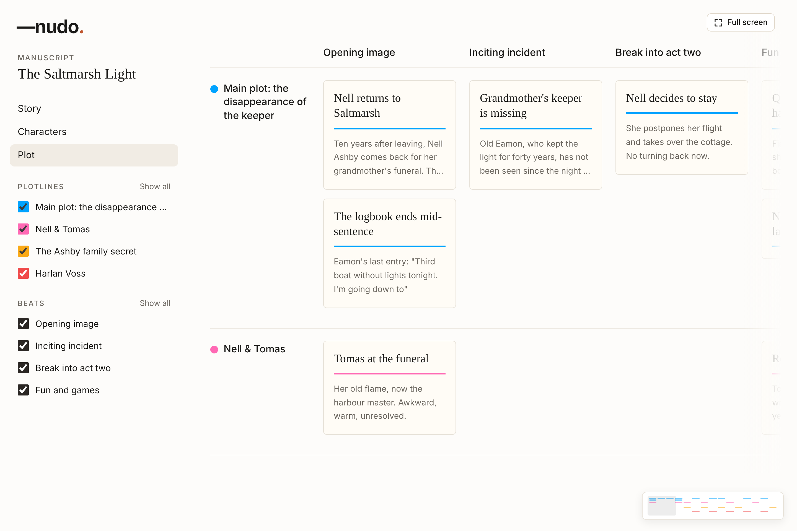
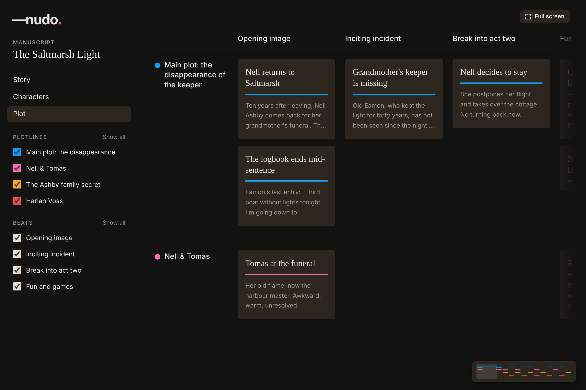
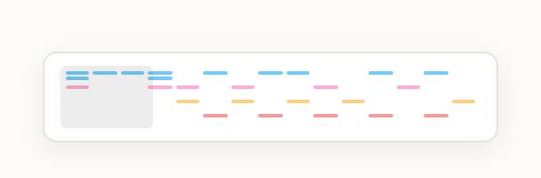
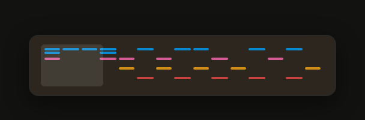

# Spec: Plot minimap

> Status: Approved
> Branch: `feat/plot-minimap`
> Depends on: `docs/specs/plot.md` (board, §7.1), `docs/specs/plot-sidebar.md` (filters)
> Visual reference: `docs/design-handoffs/plot-minimap/` (four PNGs: board and close-up, light and dark). It holds images only, with no handoff README. This spec is the source of truth.
> Plan: `docs/specs/plot-minimap.plan.md` · Tasks: `docs/specs/plot-minimap.tasks.md`

## 1. Objective

The Plot board scrolls in both directions inside its scroll container. With more than about three beats, or more than a couple of plotlines, most of the board is off-screen and writers lose track of it.

A **minimap** floats in the bottom-right corner of the board. It draws the whole board in miniature, with each card as a small mark in its plotline colour. A **frame** marks the part that is on screen. Writers drag the frame, or click anywhere in the minimap, to move around the board **horizontally and vertically**. It works in light and dark mode.

### User stories

- As a writer, I can see at a glance how big the board is and which part of it I'm looking at.
- As a writer, I can see where cards sit across all beats and plotlines (busy areas, empty areas) without scrolling.
- As a writer, I can drag the frame in any direction to move around the board, or click a spot to jump straight there.
- As a writer, I can scroll the board from the minimap with my trackpad or mouse wheel.
- As a keyboard user, I can move around the board from the minimap with the arrow keys, and hear where I am.
- As a writer using dark mode, the minimap matches the dark theme.

| Light | Dark |
| --- | --- |
|  |  |
|  |  |

The cards drawn in the minimap for beats 5–15 in these images are placeholder data.

## 2. Repository facts

| Question | Answer from the repo |
| --- | --- |
| Board component | `features/plot/components/board/plot-board.tsx` |
| Scroll container | `div.min-h-0.flex-1.overflow-auto.px-10.pb-8` inside `PlotBoard`. It scrolls on **both axes**; the window never scrolls sideways (`plot.md` §7.1). |
| Grid | `div[role="table"][aria-label="Plot board"]`, `grid w-max`, `gridTemplateColumns = ${PLOT_LABEL_COLUMN_WIDTH}px repeat(n, ${PLOT_BEAT_COLUMN_WIDTH}px)` |
| Sticky parts | Beat header row: `sticky top-0` (`z-10`, corner cell `z-20`). Plotline label column: `sticky left-0 z-10` with `COVER_GUTTER` |
| Sizes | `PLOT_LABEL_COLUMN_WIDTH = 180`, `PLOT_BEAT_COLUMN_WIDTH = 240` (`plot.constants.ts`). Row heights depend on their cards. |
| Visible items | `visiblePlot(plot, view)` (`lib/plot.utils.ts`) with `usePlotView(projectId)`; hidden plotlines/beats are not rendered |
| Plotline colours | `PLOTLINE_COLOR_VAR[color]` → `var(--plot-*)` (for inline styles; black turns white in dark mode) |
| Theme | `.dark` class on `<html>` (`useApplyTheme`); Tailwind `dark:` variant; tokens in `packages/ui/src/tailwind.css` |
| Card drag | `DndContext` in `PlotBoard`; `dragging` state is non-null during a drag |
| Reduced motion | `matchMedia('(prefers-reduced-motion: reduce)')` (already mocked in `src/test/media.test.ts`) |

## 3. When it shows

- The minimap renders whenever the scroll container overflows on **either** axis (`scrollWidth > clientWidth` or `scrollHeight > clientHeight`).
- It disappears when nothing overflows and comes back as soon as something does, e.g. after resizing the window, hiding beats or plotlines, or adding cards.
- It isn't rendered in the "Everything is hidden." state, because there's no board.
- It works the same in view-only mode (<1024px), because navigating doesn't edit the plot.

## 4. Placement and look

- **Position:** a new `relative min-h-0 flex-1` wrapper around the scroll container. The minimap sits at `absolute right-6 bottom-5` inside it, above the sticky header and label column (`z-30`).
  - It is offset by the scroll container's native scrollbar size (`offsetWidth − clientWidth`, `offsetHeight − clientHeight`), so it never covers a scrollbar.
- **Box:** `w-fit`, hugging the miniature so there is no empty strip when the height limit wins (at most `PLOT_MINIMAP_WIDTH`, 256px), `px-3 py-2.5`, `rounded-lg`, `border border-border`, `bg-popover`; in dark mode `dark:bg-[color-mix(in_oklab,var(--card),var(--foreground)_10%)]` and `dark:border-foreground/15`.
  - In dark mode `--popover` and `--card` are the same colour, so a popover-coloured box disappears over cards, and the darker `--muted` disappears over the page. Lifting the card colour towards the foreground keeps it distinct from both.
  - Shadow: Tailwind utilities, the closest to the reference (`0 4px 16px` at 8% in light, `0 6px 20px` at 45% black in dark): `shadow-lg dark:shadow-black/45`. `shadow-lg` has the nearest blur (15px). The dark shadow keeps its size and only gets a stronger, black colour.
- **Tokens and utilities only:** no hard-coded colour values. Light and dark come from the existing tokens (`--popover`, `--border`, `--foreground`, `--ring`, `--plot-*`) and Tailwind's shadow utilities.

## 5. The miniature

The miniature is a scaled drawing of the **scrollable part of the board**: everything except the sticky beat header row and the sticky plotline label column.

- **Scale:** `s = min(innerWidth / regionWidth, PLOT_MINIMAP_MAX_HEIGHT / regionHeight)`.
  - `innerWidth` is the box width minus padding (232px).
  - `PLOT_MINIMAP_MAX_HEIGHT` is 120px.
  - The miniature is `regionWidth × s` by `regionHeight × s`, aligned top-left in the box. A tall board makes it narrower; a wide board makes it shorter.
- **Card marks:** one per visible card, positioned and sized from that card's rendered rectangle in the grid, scaled by `s`.
  - Minimum height 2px, minimum width 4px; `rounded-[1px]`.
  - Colour: `PLOTLINE_COLOR_VAR[plotline.color]` at **55% opacity in light** and **80% in dark** (`opacity-55 dark:opacity-80`).
- **Nothing else is drawn:** no text, beat names, plotline names, grid lines or empty cells. The marks alone show the board's shape.
- **Decorative:** the miniature is `aria-hidden`. Its accessible behaviour lives on the frame (§8).
- **When it updates:** card rectangles and row heights are re-measured when the grid resizes (`ResizeObserver` on the grid) and when the visible plot changes (cards, order, filters, colours). They are never re-measured on scroll.

## 6. The frame

- **Size and position:** the frame is the visible part of the scrollable region, scaled by `s`, on **both axes**:
  - `x = viewX × s`, `y = viewY × s`, `width = viewWidth × s`, `height = viewHeight × s`
  - `view*` is the part of the region not covered by the sticky header and label column.
  - It is clamped to the miniature and never smaller than `PLOT_MINIMAP_MIN_FRAME` (12px) on either side, so it stays easy to grab.
  - The scroll container can scroll past the region: its padding, the space before the label column sticks, and the "+ Plotline" button below the grid. When it does, the frame stays clamped at the region's edge. It never goes outside the miniature.
- **Look:**
  - At rest: `bg-foreground/8` (light), `dark:bg-foreground/10`, `rounded-[3px]`, `cursor-grab`.
  - On hover, focus-visible and while dragging: a 1.5px outline in `foreground` at 60%, which meets 3:1 non-text contrast in both themes. While dragging the cursor is `cursor-grabbing`.
- **Following the board:** any scroll of the board on either axis (trackpad, wheel, Shift+wheel, scrollbars, keyboard, card focus scrolling into view, dnd-kit auto-scroll) moves the frame in the same animation frame.

## 7. Navigating with the pointer and wheel

All navigation sets `scrollLeft` and `scrollTop` on the board's scroll container. The browser keeps the beat header and label column sticky as normal.

- **Drag the frame:** the board scrolls on **both axes**, live, following the pointer.
  - The point where the frame was grabbed stays under the pointer, so the frame never jumps.
  - Uses pointer events with pointer capture, so the drag continues outside the minimap.
- **Press elsewhere in the miniature:** the board jumps so the frame is centred on that point, on both axes, clamped at the edges.
  - If the pointer stays down, the drag continues from there, as in VS Code.
- **Wheel and trackpad over the minimap:** `deltaX` scrolls the board horizontally and `deltaY` vertically. Shift+wheel turns vertical wheel movement into horizontal.
  - The page itself never scrolls (`preventDefault` on a non-passive wheel listener).
- **Motion:** jumps (press, keyboard) use smooth scrolling, unless `prefers-reduced-motion: reduce` is set, in which case they're instant. Dragging and wheel scrolling are always direct, never smoothed.
- **During a card, beat or plotline drag:** the minimap gets `pointer-events-none` and 40% opacity, so it never blocks a drop under it. It returns to normal when the drag ends.

## 8. Keyboard and screen readers

- **Focusable frame:** the frame is the minimap's only focusable element (`tabIndex={0}`). It comes after the board in the tab order.
  - It uses `role="group"`, `aria-roledescription="minimap"` and `aria-label="Board position"`, with `aria-controls` pointing to the scroll container's id.
  - No shadcn component fits a two-axis scroll control, so this is a styled `div`. The no-raw-element rule doesn't apply here.
- **Keys** (when the frame is focused; each key also stops the page from scrolling):

  | Key | Action |
  | --- | --- |
  | `←` / `→` | Previous / next beat column (its left edge lands just right of the sticky label column) |
  | `↑` / `↓` | Previous / next plotline row (its top lands just below the sticky beat header) |
  | `PageUp` / `PageDown` | One viewport up / down |
  | `Shift+PageUp` / `Shift+PageDown` | One viewport left / right |
  | `Home` / `End` | First / last beat, keeping the vertical position |
  | `Ctrl+Home` / `Ctrl+End` (`⌘` on macOS) | Top-left / bottom-right of the board |

- **Position text:** "Beats 2–4 of 15 · Plotlines 1–3 of 4".
  - It counts only visible beats and plotlines, and includes any that are at least partly on screen.
  - It is announced through a visually hidden `role="status"` region after keyboard moves, debounced by 300ms. It isn't announced on ordinary scrolling.

## 9. Constants

These go in `plot.constants.ts`:

```ts
export const PLOT_MINIMAP_WIDTH = 256;
export const PLOT_MINIMAP_MAX_HEIGHT = 120;
export const PLOT_MINIMAP_MIN_FRAME = 12;
export const PLOT_MINIMAP_MARK_MIN_HEIGHT = 2;
export const PLOT_MINIMAP_MARK_MIN_WIDTH = 4;
export const PLOT_MINIMAP_ANNOUNCE_DELAY = 300;
```

## 10. Tech stack

The existing stack (`plot.md` §20), with **no new dependencies**. The miniature is plain DOM: absolutely positioned `div`s with inline `left/top/width/height` and `backgroundColor`.

## 11. Commands

```bash
pnpm dev:web                         # web only, no Docker
pnpm test:web plot-minimap           # the minimap's unit + component tests
pnpm test:web plot-board             # board tests touched by the wrapper change
pnpm storybook                       # stories (port 6006)
pnpm test:e2e                        # Playwright journey
pnpm lint
pnpm typecheck
```

## 12. Code layout

```
apps/web/src/features/plot/
├── constants/plot.constants.ts            ← §9 constants
├── lib/plot-minimap.ts (+ .test.ts)       ← pure geometry (§13)
├── hooks/use-plot-minimap.ts              ← measuring, scroll sync, pointer/wheel/keys
└── components/board/
    ├── plot-board.tsx                     ← wrapper + refs + renders <PlotMinimap>
    └── plot-minimap.tsx (+ .test.tsx)     ← box, marks, frame, status
packages/ui/stories/plot-minimap.stories.tsx
e2e/tests/plot.spec.ts                     ← extended (§14)
```

The only change to `plot-board.tsx` is:
- the wrapper `div`;
- refs on the scroll container and the grid;
- an id on the scroll container;
- rendering `<PlotMinimap>` with the `dragging` flag and the visible plot.

## 13. Code style

The geometry is pure and works in board pixels, so it can be unit tested without layout:

```ts
export interface MinimapMetrics {
  regionWidth: number;  // grid width minus the label column
  regionHeight: number; // grid height minus the beat header row
  viewX: number;        // scrolled offset into the region
  viewY: number;
  viewWidth: number;    // visible region size (container client size minus sticky parts)
  viewHeight: number;
  originX: number;      // scrollLeft at which the region's left edge meets the stuck label column
  originY: number;      // scrollTop at which the region's top edge meets the stuck beat header
  maxScrollLeft: number; // scrollWidth − clientWidth
  maxScrollTop: number;  // scrollHeight − clientHeight
}

// viewX = clamp(scrollLeft − originX, 0, regionWidth − viewWidth), and the same for Y.
// Going back: scrollLeft = viewX + originX, clamped to 0..maxScrollLeft.

export function minimapScale(m: MinimapMetrics, innerWidth: number, maxHeight: number) {
  return Math.min(innerWidth / m.regionWidth, maxHeight / m.regionHeight);
}

export function frameRect(m: MinimapMetrics, scale: number, minSize: number) { /* clamp to region */ }

export function scrollForFrameAt(m: MinimapMetrics, scale: number, frameX: number, frameY: number) {
  /* → { left, top } for the scroll container, clamped to 0..max */
}

export function scrollToCentreOn(m: MinimapMetrics, scale: number, pointX: number, pointY: number) {
  /* → { left, top } */
}
```

The hook measures `MinimapMetrics` from DOM rectangles:
- the grid;
- the beat header row;
- the label column;
- the scroll container's `clientWidth`, `clientHeight`, `scrollLeft` and `scrollTop`.

It measures from these rectangles, never from hard-coded padding, so padding changes don't break it.

`originX`/`originY` are the grid's offset inside the scroll content: grid rect minus container rect, plus the current scroll. Today `originX` is the 40px `px-10` gutter, which scrolls by before the label column sticks, and `originY` is 0. The "+ Plotline" button and `pb-8` are why `maxScrollTop` can be larger than `originY + regionHeight − viewHeight`.

Rules:
- Scroll position is never React state. A passive `scroll` listener schedules one `requestAnimationFrame`, which writes the frame's `transform` and size directly through a ref. Scrolling never re-renders the board or the marks.
- Use `@ui/components/ui/*` first.
- Use path aliases. Files are kebab-case, components PascalCase.
- Comments explain why, never what.

## 14. Testing

Following `.claude/rules/testing.md`:

- **Unit** (`lib/plot-minimap.test.ts`), covering every geometry function:
  - scrolled to the start, middle and end;
  - overflow on one axis only and on both axes;
  - width-limited vs height-limited scale;
  - the frame clamped at each edge;
  - the minimum frame size;
  - centring near the edges;
  - the position text ranges ("Beats 2–4 of 15 · Plotlines 1–3 of 4").
- **Component / integration** (`plot-minimap.test.tsx`, `renderWithProviders` + MSW for the plot query):
  - jsdom has no layout, so stub `scrollWidth`/`clientWidth`/`scrollHeight`/`clientHeight` and the element rects.
  - Not rendered without overflow; rendered with overflow on either axis.
  - One mark per visible card, and hidden plotlines and beats produce no marks.
  - Each key in §8 sets the expected `scrollLeft`/`scrollTop`.
  - The `role="status"` text after a key move.
  - `pointer-events-none` while a drag is in progress.
- **Storybook** (`plot-minimap.stories.tsx`), light and dark for each:
  - wide board;
  - tall board (height-limited);
  - board overflowing on both axes;
  - frame scrolled to the middle;
  - frame focused;
  - card-drag-in-progress state.
- **E2E** (`e2e/tests/plot.spec.ts`), on a board with enough beats and plotlines to overflow both ways:
  - dragging the frame diagonally scrolls the board on both axes;
  - pressing a corner of the miniature centres the view there;
  - arrow keys on the focused frame move by beat and plotline;
  - scrolling the board moves the frame.
  - Drive the minimap drag with `page.mouse` (it's a plain pointer drag, not dnd-kit).

## 15. Boundaries

**Always**
- Read the board's data and scroll position only: the minimap never changes plot data.
- Respect plotline and beat filters.
- Support light and dark mode through the existing tokens.
- Ship tests and stories per §14.

**Ask first**
- Adding any dependency.
- Adding tokens to `packages/ui/src/tailwind.css`.
- Changing `plot-board.tsx` beyond what §12 lists.

**Never**
- Edit `packages/ui/src/components/ui/`.
- Push or open a PR without explicit approval.

## 16. Success criteria

- [ ] With a board that overflows on either axis, the minimap appears bottom-right and matches the reference images in light and dark.
- [ ] With no overflow, it isn't in the DOM.
- [ ] Scrolling the board on either axis, by any means, moves the frame in the same animation frame, without re-rendering the board.
- [ ] Dragging the frame moves the board on both axes with no jump at the start.
- [ ] Pressing in the miniature centres the view on that point, and continuing to hold drags.
- [ ] Wheel and trackpad over the minimap scroll the board on both axes and never the page.
- [ ] Every key in §8 works, and the position text is shown on hover/focus and announced after key moves.
- [ ] The frame outline meets 3:1 contrast in both themes.
- [ ] Hiding/showing plotlines or beats, adding/moving/deleting cards and resizing the window update the minimap immediately.
- [ ] Card, beat and plotline drags work everywhere, including under the minimap.
- [ ] With reduced motion, jumps are instant.
- [ ] Unit, component, story and e2e layers from §14 exist and pass; lint and typecheck are clean.

## 17. Open questions

1. `PLOT_MINIMAP_MAX_HEIGHT` (120px) and `PLOT_MINIMAP_MIN_FRAME` (12px) are first guesses. Should they be tuned after trying it on a real manuscript?
